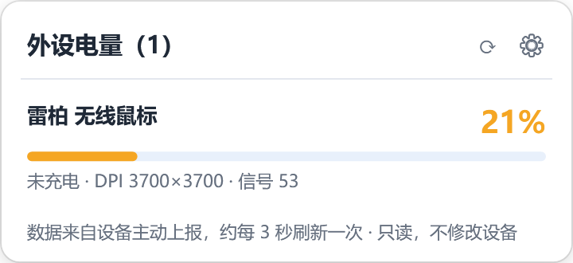

# PeripheralBattery

托盘显示无线外设电量的 Windows 小工具。单一 exe，双击即用，**只读、不联网、不发命令**。


> **English** — A tiny Windows tray utility that shows the battery level of 2.4 GHz wireless
> peripherals (currently Rapoo receivers). It only *listens* to the status frames the device
> pushes on its vendor HID collection — no commands are ever sent, no network access, no
> background service. Single self-contained 64 MB executable.

---

## 界面

左键点托盘图标，弹出面板：



| 操作 | 结果 |
|---|---|
| 托盘图标 | 圆形进度环 + 中间数字。环走一圈 = 满电，弧长 = 剩余电量 |
| 左键单击 | 面板：设备名、电量条、充电状态、DPI、信号强度；再点一下关闭 |
| 右键 | 显示面板 / 立即刷新 / 开机自启 / 设置 / 关于 / 退出 |

图标颜色：绿色 ≥50% / 橙色 20–49% / 红色 <20% / 灰色表示没读到。数字颜色跟随任务栏深浅自动切换。

---

## 为什么不能"直接读 Windows 的电池"

因为 Windows 根本没有这个接口。实测这台机器：

- 37 个 HID 接口里，**标准电量字段（Usage Page `0x06` / Usage `0x20`）一个都没有**
- `Windows.Devices.Power.Battery` 只枚举到笔记本自己的 ACPI 电池，没有外设节点

所以只能解析厂商自己的私有协议。数据来自接收器每 3–9 秒主动上报的一条 **19 字节状态帧**：

| 字节（0 起，含 report id） | 含义 | 验证情况 |
|---|---|---|
| 0 | report id（`0x07`） | — |
| 1 | 协议（低 4 位）/ 传感器（高 4 位） | — |
| 2 | CPI 档位 | — |
| 3–4 | X 轴 DPI（小端 16 位） | ✅ 3700，与官方驱动一致 |
| 5–6 | Y 轴 DPI（小端 16 位） | ✅ 3700 |
| 7 | 充电状态 | ⚠️ 只确认 `1 = 未充电`，其它取值含义未验证 |
| **8** | **电量百分比 0–100** | ✅ 驱动显示 21% 时该字节为 `0x15` |
| 9–11 | 灯效 / 回报率 / 刷新标志 | — |
| 12 | 配置槽 | — |
| 13–14 | usbPid（小端） | — |
| 15 | 按键 / 滚轮类型 | — |
| 16 | 射频类型 | — |
| 17 | 传感器模式 | — |
| 18 | 连接标志（bit7）+ 信号强度（低 7 位） | ✅ 46–57 随距离抖动 |

字段布局来自雷柏网页驱动（`hub.rapoo.cn`）前端 bundle 里的 `VTLM20RTMouseDevice.parseUserCustomData`，
并用真机交叉验证：官方驱动显示 21% 时解析出的字节正是 21%，DPI 3700 也吻合。

解析时有强制校验——电量必须 ≤100、DPI 必须在 100–32000、配置槽必须 ≤15，任何一项不合理就整帧丢弃。
**宁可空着，也不显示猜的数字。**

---

## 支持范围

| 设备 | 状态 |
|---|---|
| 雷柏 2.4G 接收器（VID `24AE`） | ✅ 已验证（`PID 1410`，鼠标） |
| 雷柏键盘 | ⬜ 未验证（网页驱动里键盘变体字段位置不同） |
| 罗技 LIGHTSPEED（HID++） | ⬜ 未实现，有公开资料，相对好加 |
| 蓝牙键鼠 / 耳机 | ⬜ 未实现（需要走 BLE 电池服务 `0x180F`） |
| 其它 2.4G 接收器 | ❌ 多数读不到：只转发按键和位移，硬件本身不带电量数据 |

新增一个品牌 = 抓一次它自己的协议 + 写一个解析器，不是改个开关就能通吃。

---

## 使用

1. 下载 Release 里的 `PeripheralBattery.exe`
2. 双击运行。**不会弹窗**，程序只驻留在右下角托盘
3. 找不到图标？Windows 11 会把新图标收进 `^` 折叠区，拖到任务栏固定即可
4. 右键 → 设置：低电量阈值、休眠判定、开机自启

配置和日志在 `%LOCALAPPDATA%\PeripheralBattery\`。卸载：退出程序 → 删除 exe → 删除该目录。

### 命令行

```
PeripheralBattery.exe --console --seconds=25   不开界面，打印当前读数（核对用）
PeripheralBattery.exe --tray                   静默启动，只驻留托盘
PeripheralBattery.exe --shot=out.png           截图（诊断用）
```

---

## 从源码构建

需要 .NET 8 SDK。仓库里带了 `build.bat`，会自动把 SDK 装到用户目录（**不需要管理员权限**）：

```bat
build.bat
```

产物：`dist\PeripheralBattery.exe`（约 64 MB，自包含单文件）+ `dist\tools\Probe.exe`（诊断工具）。

### 目录结构

```
src/App/         主程序（WPF + WinForms 托盘，单文件发布）
  Hid.cs         HID 枚举与设备属性（setupapi / hid.dll 的 P/Invoke）
  DeviceMonitor  设备监视：每通道一个专用线程，断线自动重连
  StatusDecoder  19 字节状态帧解码 + 合理性校验
  Ui.cs          托盘图标绘制（多尺寸 ico）与右键菜单
  Windows.cs     面板 / 设置窗口（纯代码构建，无 XAML）
src/Probe/       只读探测工具：打印全部 HID 接口的字段定义
tools/           仅开发期使用，不入库
```

### 诊断工具

`Probe.exe` 只读枚举本机全部 HID 接口，输出每个集合的 VID/PID、用途页、报告长度和字段定义。
想给新设备加适配时，先用它看设备到底声明了什么：

```
Probe.exe --decode --seconds=20     监听厂商通道并按已知规则解码
Probe.exe --vendor --seconds=40     列出全部厂商通道的原始报文
```

> `Probe` 的代码里**故意不声明** `HidD_SetFeature` / `WriteFile`，物理上不存在写入通道。

---

## 已知限制

- 设备休眠后上报间隔会拉长（实测使用中约 3 秒，深度空闲约 45 秒一次），超过 90 秒才判为"暂无上报"
- 托盘图标最小 16px 时数字会比较挤，这是像素尺寸的物理上限
- 充电状态只确认了 `1 = 未充电`，界面不会显示"充电中"
- 无数字签名，首次运行可能触发 SmartScreen 提示

## 隐私

程序不访问网络、不写注册表（除"开机自启"那一项 HKCU 键）、不读文件、不上传任何数据。
唯一的外部交互是通过 `hid.dll` 读取设备主动上报的报文。

## License

[MIT](LICENSE)
